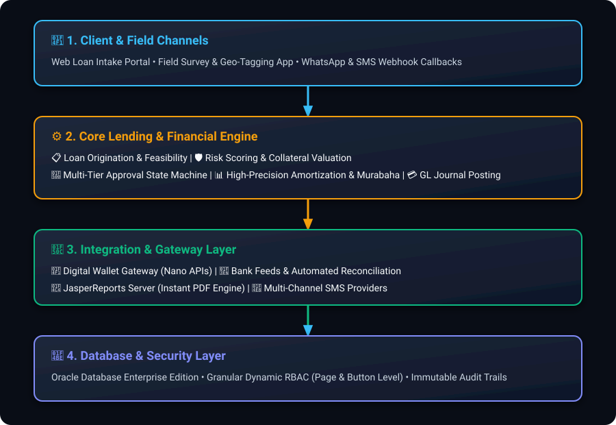

# 💰 Enterprise Loan & Amortization Engine API

[](https://www.python.org/)
[](https://fastapi.tiangolo.com/)
[](app/db)
[](http://localhost:8000/dashboard)
[](#-system-architecture)
[](LICENSE)

> **High-Precision Financial Amortization, Credit Workflow State Machine, Database Persistence & Interactive Web Dashboard**  
> Built as a public portfolio demonstration of complex financial calculation engines, state machine lifecycles, and modern RESTful backend architectures with full PostgreSQL/SQLAlchemy ORM integration.

---

## Implementation context

This repository contains a Python/FastAPI portfolio demo. The [Oracle implementation case study](docs/CASE_STUDY.md) describes related Oracle APEX, PL/SQL, and ORDS work. This demo is a separate implementation and does not contain the original enterprise application.

## 🖥️ Interactive Web UI Dashboard

The service includes an interactive single-page financial dashboard with live charts and real-time state machine transitions:

* **Interactive Amortization Calculator:** Sliders & numeric inputs with instant calculation of Equal Installments (Annuity), Reducing Balance, and Islamic Murabaha methods.
* **Repayment Breakdown Chart (Chart.js):** Visual progression of principal reduction vs profit/interest payments over time.
* **Credit Approval State Machine Pipeline:** Submit, review, approve, disburse, and settle loans directly from the web interface.
* **Audit Trail Viewer:** Real-time chronological audit history for each application.
* **1-Click PDF & CSV Export:** Download client-ready PDF statements or CSV schedules directly from the browser.

---

## 🏛️ System Architecture

<p align="center">
  
</p>

---

## ✨ Key Financial & Technical Features

### 1. Multi-Strategy Amortization Engine
* **Equal Installments (Annuity / French Method):** Fixed periodic payment where interest decreases and principal repayment increases:
  $$\text{PMT} = P \times \frac{r(1+r)^n}{(1+r)^n - 1}$$
* **Reducing Balance (Declining Principal):** Equal principal repayments per cycle with interest computed strictly on remaining outstanding balance.
* **Flat Rate / Islamic Murabaha (المرابحة الإسلامية):** Fixed profit calculated upfront over the entire loan term, divided equally across installments.
* **Grace Period Support (فترة السماح):** Deferred principal repayment with profit-only servicing during initial months.

### 2. Credit Lifecycle State Machine
Strict finite state machine governing credit transitions:
`DRAFT` ➔ `SUBMITTED` ➔ `CREDIT_REVIEW` ➔ `APPROVED` ➔ `DISBURSED` ➔ `ACTIVE` ➔ `SETTLED` / `DEFAULTED`.

### 3. Early Settlement & Unearned Profit Rebate Engine
Computes exact payoff amounts, deducting unearned future profit according to institution rebate percentage policies.

### 4. Dynamic PDF Repayment Schedule & Contract Export
Automated generation of client-ready PDF repayment schedules and statements.

### 5. Modern Database Persistence (SQLAlchemy & PostgreSQL)
* **SQLAlchemy ORM Models:** Full domain entities for `LoanApplicationModel`, `AuditLogModel`, and `DynamicRBACRuleModel`.
* **PostgreSQL DDL Migration:** Ready-to-deploy schema in [`app/db/postgres_schema.sql`](app/db/postgres_schema.sql) with check constraints, indexing, and auto-update triggers.
* **Zero-Configuration SQLite Fallback:** Automatically spins up `loans.db` locally when PostgreSQL is not configured.

---

## 🚀 Quickstart Guide

### Prerequisites
* Python 3.10+ installed

### 1. Install Dependencies
```bash
pip install -r requirements.txt
```

### 2. Run the API Server & Dashboard
```bash
uvicorn app.main:app --reload --port 8000
```
Open your browser and navigate to:
* **Interactive Financial Dashboard:** [http://localhost:8000/dashboard](http://localhost:8000/dashboard) (or [http://localhost:8000/](http://localhost:8000/))
* **Interactive Swagger UI:** [http://localhost:8000/docs](http://localhost:8000/docs)
* **ReDoc Documentation:** [http://localhost:8000/redoc](http://localhost:8000/redoc)


---

## 🐳 Docker Deployment

Run with Docker in a single command:
```bash
docker-compose up --build
```

---

## 🧪 Running Automated Tests

Run the zero-dependency test suite:
```bash
python tests/run_tests.py
```

---

## 📡 API Endpoints Overview

| Method | Endpoint | Description |
| :--- | :--- | :--- |
| `POST` | `/api/v1/calculator/schedule` | Generates full loan amortization schedule |
| `POST` | `/api/v1/calculator/early-settlement` | Calculates early settlement payoff & profit rebate |
| `POST` | `/api/v1/loans` | Creates a new loan application in `DRAFT` state |
| `GET` | `/api/v1/loans` | Lists all loan applications |
| `GET` | `/api/v1/loans/{id}` | Retrieves full loan profile and audit history |
| `PATCH`| `/api/v1/loans/{id}/status` | Advances loan through the approval state machine |
| `GET` | `/api/v1/loans/{id}/export-pdf`| Generates and downloads repayment schedule as PDF |

---

## 📂 Related Case Study

This public demo reflects the core algorithms of an enterprise 350+ module microfinance core banking system:  
👉 **[Read the Full Enterprise Case Study](docs/CASE_STUDY.md)**
