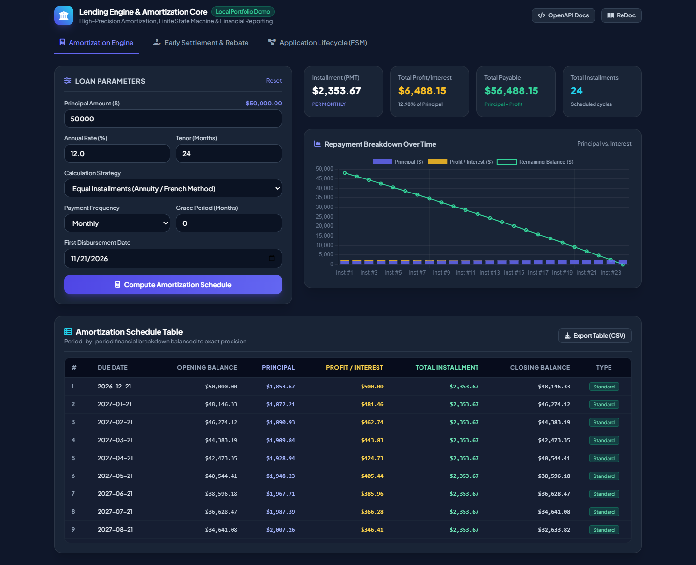

# Loan & Amortization API — Python portfolio demo

[](https://github.com/mahmoodsufyan/loan-management-system/actions/workflows/tests.yml)
[](https://python.org)
[](LICENSE)

A FastAPI demonstration of loan repayment calculations, a credit workflow, database persistence and repayment exports.

Built by **Mahmood Sufyan**, Oracle APEX & PL/SQL developer working on AI applications and Python backends. [Portfolio](https://mahmoodsufyan.github.io/) · [Related Oracle case study](docs/CASE_STUDY.md)

## Preview



The public Python implementation is separate from my private Oracle APEX/PLSQL work. It demonstrates selected concepts, not a complete enterprise lending platform.

## Implemented features

- Equal-installment, reducing-balance and flat-profit repayment calculations.
- Configurable repayment frequency and grace periods.
- Early settlement and unearned-profit rebate calculations.
- Credit status transitions and stored status history.
- SQLAlchemy persistence with local SQLite by default.
- Interactive calculator and PDF/CSV repayment outputs.

Flat-profit/Murabaha examples demonstrate arithmetic; they do not establish product, Sharia or regulatory approval.

## Local setup

Use Python 3.11 or newer, create a virtual environment, then:

```bash
pip install -r requirements.txt
uvicorn app.main:app --host 127.0.0.1 --port 8000
```

After startup: [dashboard](http://127.0.0.1:8000/dashboard), [API docs](http://127.0.0.1:8000/docs), [health](http://127.0.0.1:8000/health).

Alternatively, `docker compose up --build` binds the demo to localhost. These addresses are local, not hosted public previews. PostgreSQL DDL is provided in `app/db/postgres_schema.sql`; the default local setup and CI use SQLite. A PostgreSQL driver/configuration and separate verification are needed before claiming PostgreSQL compatibility.

## Example calculation

Use `POST /api/v1/calculator/schedule` through `/docs` with this synthetic example:

```json
{
  "principal": "50000.00",
  "annual_rate": "12.00",
  "tenor_months": 24,
  "method": "equal_installments",
  "frequency": "monthly",
  "grace_period_months": 0
}
```

The response includes `total_installments`, `total_profit`, `total_payable` and a period-by-period `schedule`. For this monthly example there are 24 installments and the final closing balance is zero. See `/docs` for the complete schema.

## Tests and CI

Install the project dependencies first, then:

```bash
python -m pytest -q
```

Pytest uses a disposable database rather than an existing `loans.db`. GitHub Actions runs the tests on Python 3.11 and 3.13. Coverage includes calculator totals and final balance, workflow transitions, persistence and status history. The optional `python tests/run_tests.py` unittest runner uses the configured database and should only be used with a dedicated test `DATABASE_URL`.

## Limitations

- Local educational/portfolio use only; no real borrower information should be entered.
- Authentication and production authorization are not implemented. Workflow stages do not by themselves enforce staff permissions or segregation of duties.
- This is not a complete banking system. Private Oracle integrations and screens are not included.
- Schema initialization is not a migration system, and SQLite tests do not establish production concurrency or PostgreSQL behavior.
- No measured performance, business-improvement percentage or uptime guarantee is claimed.

See the [anonymized Oracle case study](docs/CASE_STUDY.md) for the separate professional background.
