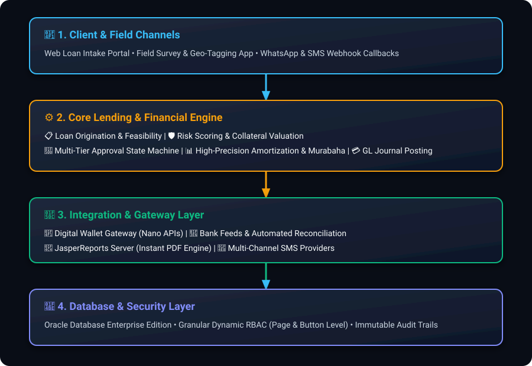
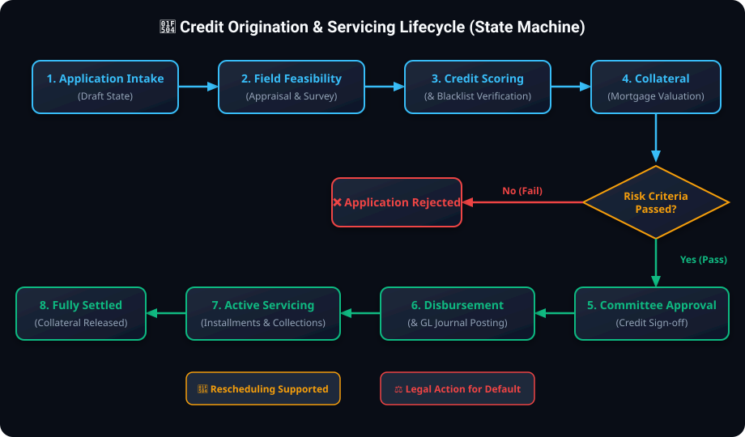
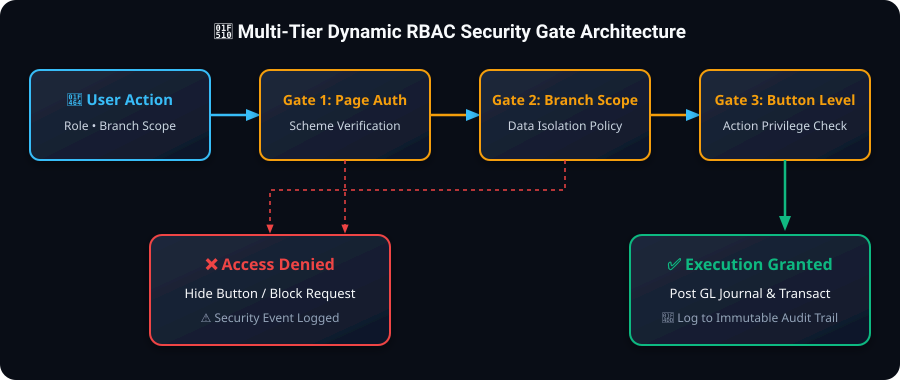

# 🏛️ Engineering Case Study: Enterprise Loan & Microfinance Operations Platform

> **Project Classification:** Enterprise Production System (Financial Institution) → **Anonymized Case Study**  
> **Scope:** Core banking and microfinance engine comprising **350+ interactive modules**, handling end-to-end loan lifecycles, automated accounting postings, and multi-channel API integrations.

---

## 1. Executive Summary

An enterprise-grade **Loan Origination and Servicing Core Platform** engineered for microfinance and commercial credit institutions. The system governs the complete lifecycle of financial facilities—from digital application intake, credit scoring, field survey appraisals, and collateral/mortgage management, to multi-tier approval state machines, automated amortization scheduling, and real-time reconciliation with commercial banks and digital payment wallets (Nano Payments).

  

---

## 2. Business Context & Problem Statement

The institution managed an expanding loan portfolio across distributed regional branches, suffering from critical operational bottlenecks:
* **Fragmented Credit Origination:** Manual transitions between feasibility studies, guarantor verifications, and physical collateral appraisals created significant turnaround delays (average 5–7 days per application).
* **Complex Financial Logic & Rescheduling:** Calculating dynamic amortization schedules (Annuity, Reducing Balance, and Islamic Murabaha/Ijara) with custom grace periods and early settlements required error-free, automated calculation engines.
* **Double-Posting & Concurrency Risks:** High-volume daily transactions from branch cashiers, bank remittances, and digital wallets created severe risks of concurrent posting conflicts and ledger discrepancies.
* **Strict Governance & Multi-Branch Segregation:** The organization required fine-grained security policies to restrict access not just by branch, but down to individual screen action buttons (e.g., "Approve Loan", "Undo Voucher Posting").

---

## 3. My Role & Key Responsibilities

As the **Lead Database & Backend Software Engineer (Oracle APEX, PL/SQL & ORDS REST APIs)**, I was responsible for:
1. **Database & Domain Architecture:** Designing normalized relational schemas, high-performance database packages, triggers, and transactional pipelines.
2. **Approval State Machine Engine:** Engineering an automated, deterministic multi-stage approval workflow (`Draft` ➔ `Feasibility` ➔ `Credit Review` ➔ `Committee Approval` ➔ `Disbursement`).
3. **RESTful API Integration Layer:** Developing secure Oracle REST Data Services (ORDS) endpoints and OAuth2 web services for digital wallet integration (Nano Payments), SMS gateways, and automated reporting.
4. **Granular Dynamic RBAC Engine:** Building a metadata-driven security framework enabling administrators to dynamically configure user permissions down to specific page buttons and UI elements without code deployments.
5. **Financial Reconciliations:** Implementing automated matching algorithms between external bank feeds, cashier deposit slips, and general ledger accounts.

---

## 4. System Architecture & Tiering

The platform is designed around a robust multi-tier enterprise architecture:

### A. Presentation & Interaction Layer (Oracle APEX)
* High-performance, responsive UI comprising **350+ interactive pages**.
* Utilizes customized Interactive Grids, KPI Gauges, and Geographic Map plugins for field inspector tracking.
* Client-side validation synchronized with database constraints via AJAX Dynamic Actions.

### B. Business & Domain Logic Layer (PL/SQL Domain Packages)
* Encapsulated, transactionally-safe PL/SQL packages handling:
  * **Amortization Engine:** High-precision calculation of installment schedules, profit distributions, and early-settlement rebates.
  * **Risk Scoring & Feasibility:** Multi-dimensional appraisal of business revenue, livestock, agricultural yields, and household expenditures.
  * **Voucher Posting Engine:** Atomic debit/credit double-entry journal generations.

### C. Integration & Gateway Layer (ORDS & REST)
* **Oracle REST Data Services (ORDS):** Provides high-throughput JSON endpoints for mobile field clients and micro-loan apps.
* **OAuth2 Authentication:** Secures communications with third-party payment providers and banking webhooks.
* **JasperReports Server Integration:** Direct REST API bridge for real-time PDF generation of promissory notes, contracts, and audit statements.

---

## 5. Credit Lifecycle State Machine

The following state machine strictly governs every credit application through its lifecycle:

  

---

## 6. Technology Stack

| Domain | Technologies Used |
| :--- | :--- |
| **Database Engine** | Oracle Database Enterprise Edition (PL/SQL Packages, Triggers, Views, Scheduler Jobs) |
| **Application Framework** | Oracle Application Express (APEX) - 350+ Enterprise Pages |
| **API & Integration** | Oracle REST Data Services (ORDS), RESTful Web Services, Webhooks, JSON |
| **Authentication & Security** | OAuth2 Client Credentials, Dynamic Session Authorization Schemes, Element-level RBAC |
| **Reporting & Export** | JasperReports Server REST API, Dynamic Interactive Grid Reports |
| **External Integrations** | Digital Wallet APIs (Nano), SMS Gateways, Bank Transaction Feeds, WhatsApp Notifications |
| **Modern Public Demo** | Python 3.11, FastAPI, Pydantic v2, Docker, Unit Tests |

---

## 7. Key Technical Challenges & Engineering Solutions

### Challenge 1: Concurrency Control & Preventing Double-Posting
* **Problem:** High concurrency across multiple branch counters and digital wallet callbacks created risks of race conditions during voucher posting.
* **Solution:**
  * Implemented pessimistic row-level locking (`SELECT ... FOR UPDATE`) inside atomic PL/SQL transaction blocks.
  * Designed an idempotent staging pipeline with unique composite transaction keys to ensure duplicate incoming webhooks are rejected safely without ledger corruption.

### Challenge 2: Dynamic Element-Level RBAC Framework
* **Problem:** Standard APEX roles were insufficient for the organization's compliance needs, which required dynamic privilege assignment per button, region, and branch without redeploying code.
* **Solution:**
  * Engineered a centralized `Security Schema` storing role-to-component mappings.
  * Connected APEX Authorization Schemes to low-overhead PL/SQL caching functions, executing sub-millisecond permission checks on every page item and action button.

  

### Challenge 3: Multi-Strategy Amortization Algorithms
* **Problem:** The platform needed to support diverse loan structures (Equal Installments, Reducing Balance, Islamic Murabaha, Agricultural seasonal installments) with configurable grace periods.
* **Solution:**
  * Built a parameterized calculation engine encapsulating annuity mathematical models, ensuring exact penny-level balancing across 100% of generated repayment schedules.

---

## 8. Key Modules Built

1. **Loan Origination & Feasibility Engine:**
   * Comprehensive customer demographic, family income, and seasonal expenditure capture.
   * Feasibility study modules for commercial, agricultural, and livestock micro-enterprises.
   * Digital document management and collateral mortgage tracking.

2. **Repayments, Collection & Accounting Posting:**
   * Single and batch payment collection vouchers with automatic GL posting.
   * Early settlement rebate calculations, partial payments, and restructuring engines.
   * Bank account reconciliation with automated discrepancy detection.

3. **Digital Wallet Hub (Nano Lending):**
   * Real-time micro-loan disbursement and installment collection via external REST APIs.
   * Automated settlement reconciliation and transaction monitoring.

4. **Multi-Channel Notification & Confirmation System:**
   * Automated SMS reminders for upcoming due dates and payment receipts.
   * WhatsApp webhook integration for instant customer communication.
   * Periodic balance confirmation cycles for field verification.

---

## 9. Business & Engineering Impact

* **100% Elimination of Double-Posting:** Atomic transaction pipelines and pessimistic locking eliminated duplicate entries and cash discrepancies across all branches.
* **Turnaround Reduced by 75%:** Streamlined digital credit workflows reduced loan application processing time from 5–7 days to under 24 hours.
* **Seamless Banking Reconciliations:** Automated bank feed imports accelerated daily cash reconciliations by 80%.
* **Scalable Architecture:** Successfully scaled to support 350+ modules and high concurrent daily operations with zero system downtime.
