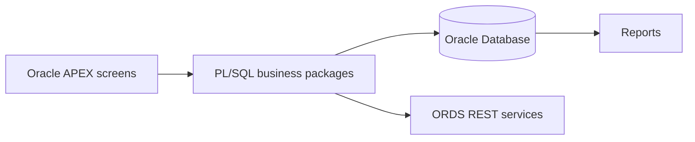

# Oracle APEX loan and microfinance workflows

## Context and ownership

This is a public, anonymized overview of my Oracle APEX, PL/SQL and ORDS work in loan and microfinance applications. The original company application and its source code are not included here.

The Python/FastAPI code in this repository is a separate portfolio demonstration. Its implemented features and tests should be assessed independently of the Oracle project described below.

## My contribution

My development work covered database structures, PL/SQL business logic, Oracle APEX screens, credit workflows, reporting and REST integrations. This describes project responsibilities, not a replacement for the employment title recorded in my CV and experience certificate.

## Functional areas

- Loan application intake and progression through review and approval stages.
- Repayment calculations, schedules and repayment-related reporting.
- Accounting-related workflows and integration through ORDS REST services.
- Application authorization and operational reporting within the Oracle application.

## Architecture overview

This diagram is a simplified explanation, not an export of the private production architecture. The public Python demo implements a smaller scope: repayment calculations, a credit state machine, persistence and PDF outputs. It does not reproduce all enterprise integrations or access controls.

## Evidence and outcomes

The work involved turning credit processes into database-backed application workflows. No independently documented turnaround, reconciliation, latency or uptime measurements are published here, so this overview makes no numerical improvement claims.

Page totals and business-module totals are different measures. Neither is used as a scope metric here without a verified inventory.

## Public demo evidence

- [Calculator](../app/core/calculator.py)
- [Credit workflow](../app/core/workflow.py)
- [Database repository](../app/services/loan_store.py)
- [Tests](../tests)
- [Setup, limitations and dashboard](../README.md)

The demo uses synthetic examples. It is not a production lending service, a security certification or a regulatory-compliance claim.
